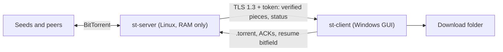

# split-torrent

Download torrents on a small Linux server and save them on a Windows PC, without
the Windows machine needing a public IP and without the server ever writing
torrent data to its disk.

- **`st-server`** (Linux CLI) talks to the BitTorrent swarm with
  [librqbit](https://github.com/ikatson/rqbit). Pieces are kept in a capped RAM
  buffer, verified (SHA-1) and streamed to the client over TLS.
- **`st-client`** (Windows GUI) connects *out* to the server, writes the pieces
  straight into the files in your download folder and acknowledges them. An
  acknowledged piece is freed on the server immediately.

## Architecture



| Crate | Purpose |
|---|---|
| `crates/st-protocol` | Wire messages (serde + postcard), length-delimited framing, piece bitfield, certificate fingerprint helpers |
| `crates/st-server` | Server library + binary: librqbit with in-memory storage, RAM budget/backpressure, TLS, config |
| `crates/st-client-core` | Platform-independent client logic (connect, write files, resume) |
| `crates/st-client` | Windows GUI (egui) |

How a session works:

1. The client opens one TLS connection to `server:7443`, checks the server
   certificate against the pinned SHA-256 fingerprint and sends the token.
2. It sends the `.torrent` file plus a bitfield of the pieces it already has.
3. The server downloads the missing pieces into RAM and sends each verified
   piece; the client writes it, re-checks it, saves its state and sends an ACK;
   the server frees the piece.
4. If the connection drops, the client reconnects and sends its bitfield again;
   the server resends every piece that was not acknowledged yet and continues.

The server never touches the disk for torrent data. Its only files are the TLS
certificate, private key and the generated token in `state_dir`.

## Server: install on Linux

Requirements: x86_64 Linux with systemd, 1 GB RAM is enough. The binary is
statically linked (musl), so there is nothing else to install.

### 1. Get the binary

Either download the `linux-musl` artifact from the latest CI run on GitHub
Actions, or build it yourself:

```bash
rustup target add x86_64-unknown-linux-musl
sudo apt-get install -y musl-tools
cargo build --release -p st-server --target x86_64-unknown-linux-musl
# -> target/x86_64-unknown-linux-musl/release/st-server
```

Install it:

```bash
sudo install -m 0755 st-server /usr/local/bin/st-server
```

### 2. Config

```bash
sudo install -m 0644 deploy/st-server.toml /etc/st-server.toml
sudoedit /etc/st-server.toml
```

Every key is optional; [`deploy/st-server.toml`](deploy/st-server.toml) documents
all of them. The ones you are most likely to change:

| Key | Default | Meaning |
|---|---|---|
| `listen` | `0.0.0.0:7443` | Address the client connects to (TLS) |
| `token` | generated | Shared secret; if unset, a random one is stored in `state_dir/token` |
| `state_dir` | `/var/lib/st-server` | TLS certificate, key and generated token |
| `buffer_limit` | `384MiB` | RAM for pieces in flight and pieces waiting for ACK |
| `max_inflight_pieces` | `32` | Downloads are throttled while this many pieces are partial |
| `bt_port` | `4240` | BitTorrent TCP port for incoming peers |
| `peer_limit` | `64` | Max peers per torrent |
| `download_limit` / `upload_limit` | `0` (unlimited) | Swarm rate limits, e.g. `"10MiB"` |
| `seed` | `true` | Serve pieces that are still in RAM to other peers |

Command-line flags override the file: `--listen`, `--token` (or
`ST_SERVER_TOKEN`), `--state-dir`, `--buffer-limit`, `--bt-port`.

### 3. systemd

```bash
sudo install -m 0644 deploy/st-server.service /etc/systemd/system/st-server.service
sudo systemctl daemon-reload
sudo systemctl enable --now st-server
journalctl -u st-server -f
```

The unit runs as a dynamic unprivileged user, makes the whole filesystem
read-only except the state directory, and caps memory at `MemoryMax=640M`
(see [memory tuning](#memory-tuning)).

### 4. Firewall

Open the client port and the BitTorrent port (TCP):

```bash
sudo ufw allow 7443/tcp   # st-client -> st-server
sudo ufw allow 4240/tcp   # incoming BitTorrent peers (bt_port)
```

or with nftables/iptables, the equivalent `tcp dport { 7443, 4240 } accept`.
DHT uses a UDP port chosen at startup; it works through outgoing traffic, so no
inbound UDP rule is required. If your provider has a cloud firewall / security
group, open the same ports there.

### 5. Swap on a 1 GB machine

The default budget (384 MiB buffer, 640 MiB cgroup cap) fits in 1 GB without
swap. A small swap is still a good safety net against the OOM killer for the
rest of the system:

```bash
sudo fallocate -l 1G /swapfile && sudo chmod 600 /swapfile
sudo mkswap /swapfile && sudo swapon /swapfile
echo '/swapfile none swap sw 0 0' | sudo tee -a /etc/fstab
echo 'vm.swappiness=10' | sudo tee /etc/sysctl.d/99-swappiness.conf && sudo sysctl --system
```

Note that disk swap can page buffered pieces out to disk. If torrent data must
never reach the disk, use compressed RAM swap (`zram`, e.g. the
`zram-tools`/`systemd-zram-generator` package) instead of a swap file, or add
`MemorySwapMax=0` to the unit so only other processes may swap.

## Getting the fingerprint and token

The client needs three things: the server address, the token and the
certificate fingerprint. Both secrets are created on first start.

```bash
sudo st-server --config /etc/st-server.toml show
# fingerprint: AB:40:51:0F:93:62:EF:70:3E:67:4E:41:DF:FA:4E:62:B6:48:B2:C7:97:08:2B:D7:73:59:43:64:77:33:A3:0F
# token:       LhgG5zZra9osnvEQHHPGGFIn3dsfA8Za
```

Run `show` after the service has started once, so it reads the files the
service created (with `DynamicUser=yes` they live in
`/var/lib/private/st-server`, linked from `/var/lib/st-server`). The
fingerprint is also printed to the journal on every start.

- To set your own token, put `token = "..."` (at least 16 characters) in the
  config; `st-server gen-token` prints a random one.
- To rotate the certificate, stop the service, delete `cert.der` and `key.der`
  from the state directory and start it again. Clients must then pin the new
  fingerprint.

## Memory tuning

The server's memory is roughly `buffer_limit` plus 100–250 MiB for librqbit,
peer connections and the runtime. Keep `buffer_limit + 256MiB <= MemoryMax`.

How the buffer is used:

- Every piece that is being downloaded, or verified and waiting for the
  client's ACK, takes its full piece size in RAM.
- **Soft limit:** at 75% of `buffer_limit`, or when `max_inflight_pieces`
  pieces are partial, swarm downloads are throttled to one 16 KiB block per
  second. Full speed resumes once usage falls below 50%.
- **Hard limit:** a new piece cannot be started while the buffer is full; the
  download waits until the client acknowledges pieces. So a slow or offline
  client stalls the download instead of growing memory.
- Torrents whose piece size is more than a quarter of `buffer_limit` are
  rejected.

Suggested settings:

| Server RAM | `buffer_limit` | `MemoryMax` | `max_inflight_pieces` | `peer_limit` |
|---|---|---|---|---|
| 512 MB | `160MiB` | `400M` | 16 | 32 |
| 1 GB (default) | `384MiB` | `640M` | 32 | 64 |
| 2 GB | `1GiB` | `1400M` | 64 | 100 |

A bigger buffer helps when the client link is slower or less stable than the
swarm: more pieces can wait for the client without stalling the download. With
very large pieces (8–16 MiB) lower `max_inflight_pieces` so partial pieces do
not crowd out pieces waiting for ACK.

## Known limitations

- **Resume after a server restart can re-download data.** The server keeps no
  state on disk, and librqbit has no public API to tell it which pieces already
  exist without reading them back. After a restart, the client's bitfield is
  used to (a) never send or keep pieces the client already has and (b) skip
  files the client already has completely. Pieces the client has *inside a
  partly downloaded file* are fetched from the swarm again and dropped.
  Reconnects while the server keeps running do not have this problem.
- **Seeding is limited to the buffer.** Only pieces still in RAM can be
  uploaded. Peers asking for a piece that was already freed are disconnected
  by librqbit. Set `seed = false` to turn uploading off entirely.
- **If the client loses pieces it had acknowledged** (e.g. its state file was
  deleted), the server restarts the torrent and downloads them again.
- One client owns a torrent at a time; adding the same torrent from a second
  connection takes it over.

## Windows client

> _To be completed with the `st-client` GUI._

The client is a single `st-client.exe` (the `windows-msvc` CI artifact). In
the GUI enter:

| Field | Value |
|---|---|
| Server address | `your-server-ip:7443` |
| Token | `token` from `st-server show` |
| Certificate fingerprint | `fingerprint` from `st-server show` |
| `.torrent` file | the torrent to download |
| Download folder | where the files are written |

<!-- TODO(client): screenshots, install steps, resume/.st-state behaviour, pause/resume/remove. -->

## Development

```bash
cargo fmt --all -- --check
cargo clippy --workspace --all-targets -- -D warnings
cargo test --workspace
```

`crates/st-server/tests/swarm.rs` runs the server against a local librqbit seed
(TLS pinning, bad token, full download, backpressure with a small buffer,
reconnect before ACK). The server can be embedded in tests with
`st_server::Server::bind(Config { .. })` and `.spawn()`.

CI (`.github/workflows/ci.yml`) runs fmt, clippy and tests on Linux and builds
release binaries for `x86_64-unknown-linux-musl` (server) and
`x86_64-pc-windows-msvc` (client).
